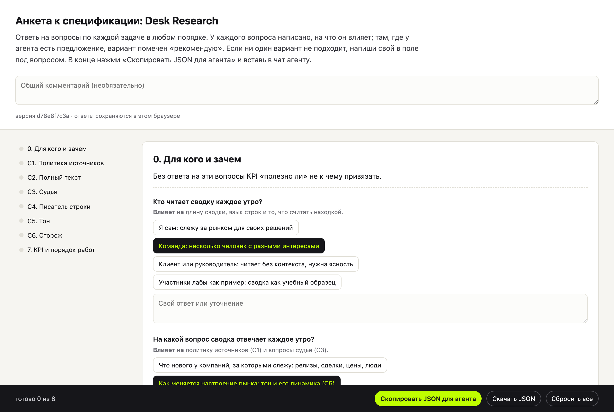
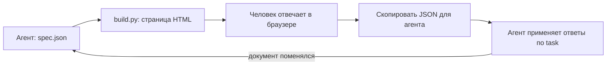
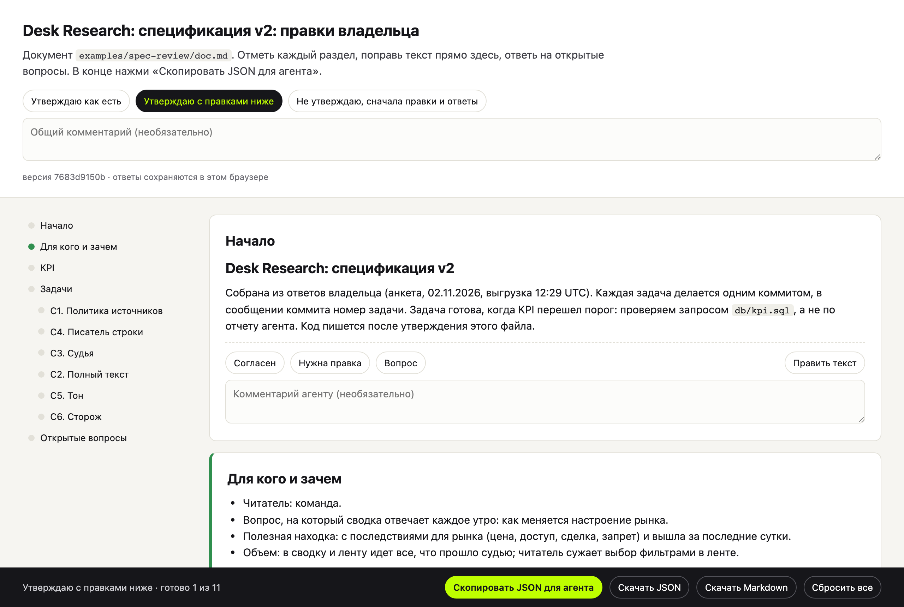
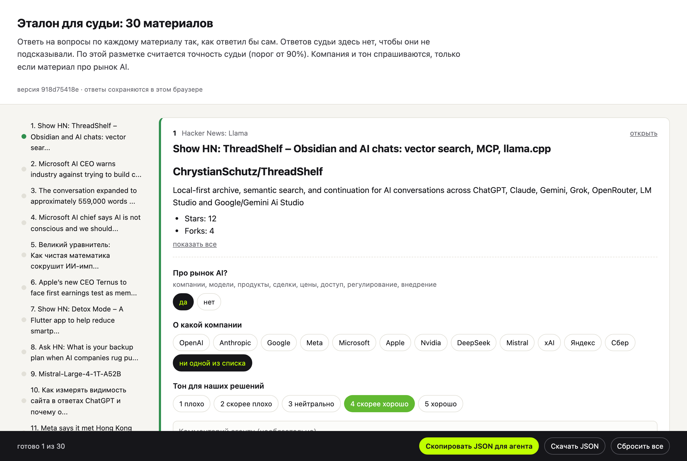

# human-in-the-loop

Скилл для Claude и других агентов, который собирает одноразовую страницу в браузере, когда агенту нужны ответы и решения человека: анкета перед спецификацией, утверждение документа по разделам, слепая разметка эталона, оценка по шкале. Человек отвечает в любом порядке, жмет «Скопировать JSON для агента» и вставляет ответ в чат. Агент получает только тронутые пункты и задание первой строкой. Сделан в [AI Lab](https://www.ai-lab-agents.com) для тех, кто только начинает работать с агентскими системами.



## Ради чего

Агенту часто нужно от человека больше двух-трех ответов сразу. Нужно утвердить спецификацию из десяти разделов, выбрать варианты по восьми открытым вопросам, разметить тридцать материалов для проверки судьи. В чате это превращается в простыню: агент задает вопросы списком, человек отвечает «1а, 2 не понял, 3 как ты сказал», половина ответов теряется или трактуется по-своему.

Страница решает это механикой. У каждого вопроса свои кнопки вариантов, строка «на что влияет» и поле для своего ответа. Прогресс виден, ответы сохраняются в браузере, к странице можно вернуться завтра. Выгрузка строгая: JSON с id вопросов, где лежат только ответы, которые человек дал. Агенту не нужно разбирать свободный текст, он применяет ответы по полю `task`.

Главный сценарий: анкета перед спецификацией. Человек отвечает на вопросы о своей системе, JSON уходит агенту, агент собирает `SPEC.md`. Потом тот же скилл собирает страницу правок самой спеки: статус каждого раздела, правка текста на месте, ответы на открытые вопросы. Код агент пишет только после утверждения.

## Что здесь сделано

- **Скилл `human-in-the-loop`**: инструкция для агента, когда собирать страницу, как описать ее в `spec.json` и что делать с выгрузкой. Работает в Claude Code, Codex, Cursor и других агентах, которые читают `SKILL.md`.
- **Сборщик страницы** (`scripts/build.py`): из `spec.json` получается один автономный HTML-файл без сервера и внешних библиотек. Только стандартная библиотека Python.
- **Заготовка из Markdown** (`scripts/from_markdown.py`): документ с разделами `##` и `###` превращается в страницу правок, раздел «Открытые вопросы» превращается в вопросы с вариантами.
- **Подсчет совпадения** (`scripts/score.py`): разметку человека сравнивает с ответами модели, печатает точность по каждому вопросу и все расхождения.
- **Три примера** (`examples/`): анкета к спецификации из 34 вопросов, правка спецификации из 11 разделов, слепая разметка 30 материалов.
- **Самопроверка** (`tests/selftest.py`): собирает все три примера, проходит их в headless Chromium и проверяет выгрузки.

## Как это работает



1. **Spec.** Агент описывает, что человеку нужно посмотреть и решить: блоки, текст в Markdown, вопросы пяти типов. Страницу руками никто не пишет.
2. **Страница.** `build.py` собирает HTML и открывает его в браузере. У страницы есть версия: если spec поменялся, старые ответы к новой странице не применяются.
3. **Ответы.** Человек проходит блоки в любом порядке. Слева оглавление с отметками готовности, внизу прогресс и кнопки выгрузки.
4. **Выгрузка.** В JSON только то, что человек тронул: статус, комментарий, старый и новый текст блока, ответы, свои варианты, общее решение по документу.
5. **Применение.** Агент делает то, что написано в `task`, и отчитывается, что изменил и что осталось открытым. Пустое решение по документу значит, что документ не утвержден: агент переспрашивает.

## Три режима

### Анкета

Вопросы с вариантами, у каждого строка «Влияет на» и поле «Свой ответ или уточнение». Варианты, которые агент советует, помечены «рекомендую». Пример: [`examples/spec-questions`](skills/human-in-the-loop/examples/spec-questions/spec.json), анкета к спецификации учебной системы Desk Research: 8 блоков, 34 вопроса, задание агенту собрать `SPEC.md` по ответам.

### Утверждение документа



Каждый раздел документа становится блоком с кнопками «Согласен», «Нужна правка», «Вопрос», полем комментария и кнопкой «Править текст». Сверху общее решение: «Утверждаю как есть», «Утверждаю с правками ниже», «Не утверждаю». Кроме JSON, страница выгружает исправленный Markdown целиком. Пример: [`examples/spec-review`](skills/human-in-the-loop/examples/spec-review/), собирается командой из раздела «Как запустить».

### Слепая разметка



Человек размечает материалы так, как ответил бы сам. Ответы модели лежат в отдельном `sidecar.json` и на страницу не попадают, поэтому не подсказывают. Вопросы могут зависеть от предыдущих: «О какой компании» появляется, только если ответ на «Про рынок AI?» был «да». После разметки `score.py` считает совпадение с моделью. Пример: [`examples/gold-labeling`](skills/human-in-the-loop/examples/gold-labeling/), 30 материалов из ленты Hacker News и Хабра.

## Типы вопросов

| Тип | Что на странице | Что в выгрузке |
|---|---|---|
| `yesno` | две кнопки | `true` или `false` |
| `choice` | один вариант из списка, можно поле для своего ответа | `value` варианта, свой текст в `notes` |
| `multi` | несколько вариантов | список `value` |
| `scale` | шкала с подписями уровней, можно цвета от красного к зеленому | число |
| `text` | поле ввода | строка |

Полный формат `spec.json`, флаги блоков, условные вопросы и формат выгрузки: [`references/spec-format.md`](skills/human-in-the-loop/references/spec-format.md).

## Установка

### Claude Code: через маркетплейс плагинов

```
/plugin marketplace add vasilievyakov/human-in-the-loop
/plugin install human-in-the-loop@ai-lab-skills
```

### Claude Code, Codex, Cursor и другие агенты: через skills CLI

```bash
npx skills add https://github.com/vasilievyakov/human-in-the-loop --skill human-in-the-loop
```

### Вручную

```bash
git clone https://github.com/vasilievyakov/human-in-the-loop.git
cp -r human-in-the-loop/skills/human-in-the-loop ~/.claude/skills/
```

Для одного проекта положи папку в `.claude/skills/` внутри проекта.

### Claude.ai (веб и десктоп)

Скачай [`dist/human-in-the-loop.skill`](dist/human-in-the-loop.skill) и загрузи его в разделе скиллов в настройках Claude.

Для скриптов нужен Python 3. Для самопроверки дополнительно `pip install playwright` и `playwright install chromium`.

## Как запустить

Напиши `/human-in-the-loop` или попроси своими словами:

> Сделай мне анкету по вопросам к спецификации, ответы отдам JSON-ом.

> Дай страницу для правок этого документа: SPEC.md.

> Нужно разметить 30 материалов вслепую, чтобы проверить судью.

Агент соберет `spec.json`, откроет страницу и скажет одной строкой, что от тебя нужно. Ответь на странице, нажми «Скопировать JSON для агента» и вставь в чат.

Скрипты можно запускать и без агента:

```bash
cd skills/human-in-the-loop
python3 scripts/build.py examples/spec-questions/spec.json -o anketa.html
python3 scripts/from_markdown.py examples/spec-review/doc.md --options examples/spec-review/options.json -o review.json
python3 scripts/build.py review.json -o review.html
python3 scripts/score.py labels.json examples/gold-labeling/sidecar.json --spec examples/gold-labeling/spec.json
```

## Проверка

```bash
python3 skills/human-in-the-loop/tests/selftest.py
```

Собирает три примера, нажимает кнопки в headless Chromium и проверяет: решение и статусы попадают в выгрузку, правка текста выгружается со старым текстом, скрытые условные вопросы не выгружаются, ответы переживают перезагрузку страницы, `score.py` читает выгрузку, сломанный `spec.json` отклоняется с понятной ошибкой.

## Ограничения

- **Ответы живут в браузере.** Они сохраняются в `localStorage` того браузера, где открыта страница. Другой браузер или другой компьютер начнет с нуля. Для передачи есть «Скачать JSON».
- **Один человек на одну страницу.** Совместной работы нет: если страницу заполняют двое, у каждого своя выгрузка.
- **Страница одноразовая.** Если агент поменял `spec.json`, страница собирается заново с новой версией, и старые ответы к ней не применяются.
- **Агент может применить ответы неточно.** Скилл задает формат и задание, но правку документа по ответам делает модель. Сверяй результат с выгрузкой, особенно правки текста.
- **Примеры и интерфейс на русском.** Подписи кнопок и примеры на русском языке, текст вопросов может быть на любом.

## Структура

```
skills/human-in-the-loop/
├── SKILL.md                     # когда брать скилл и цикл работы агента
├── references/
│   └── spec-format.md           # формат spec.json и выгрузки
├── scripts/
│   ├── build.py                 # spec.json -> автономная HTML-страница
│   ├── template.html            # шаблон страницы
│   ├── from_markdown.py         # Markdown-документ -> spec.json для правок
│   └── score.py                 # совпадение разметки человека с ответами модели
├── examples/
│   ├── spec-questions/          # анкета к спецификации, 34 вопроса
│   ├── spec-review/             # правка спецификации по разделам
│   └── gold-labeling/           # слепая разметка 30 материалов
└── tests/
    └── selftest.py              # сквозная проверка в headless Chromium
docs/img/                        # снимки страниц для README
dist/
└── human-in-the-loop.skill      # пакет для Claude.ai
.claude-plugin/
└── marketplace.json             # маркетплейс плагинов Claude Code
```

## Обратная связь

Нашел вопрос, который страница показывает криво, или выгрузку, которую агент не понял: открой issue с куском `spec.json` и выгрузкой. Новые типы вопросов и примеры принимаются через pull request, вместе с проверкой в `tests/selftest.py`.

## Лицензия

MIT.
